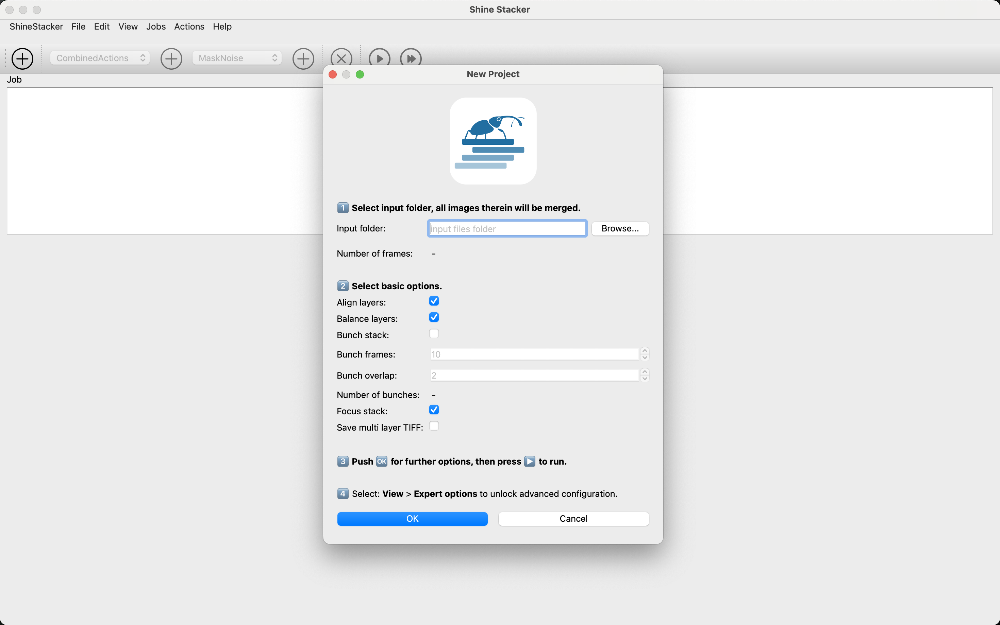
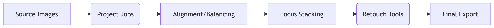
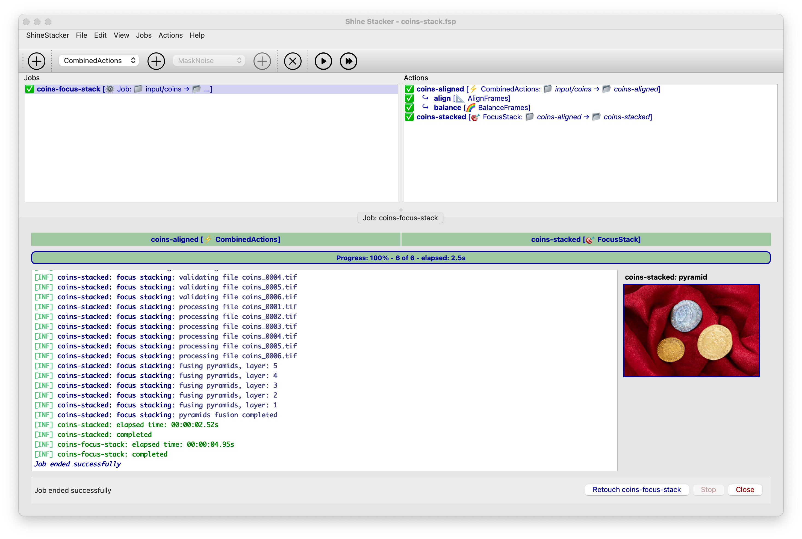
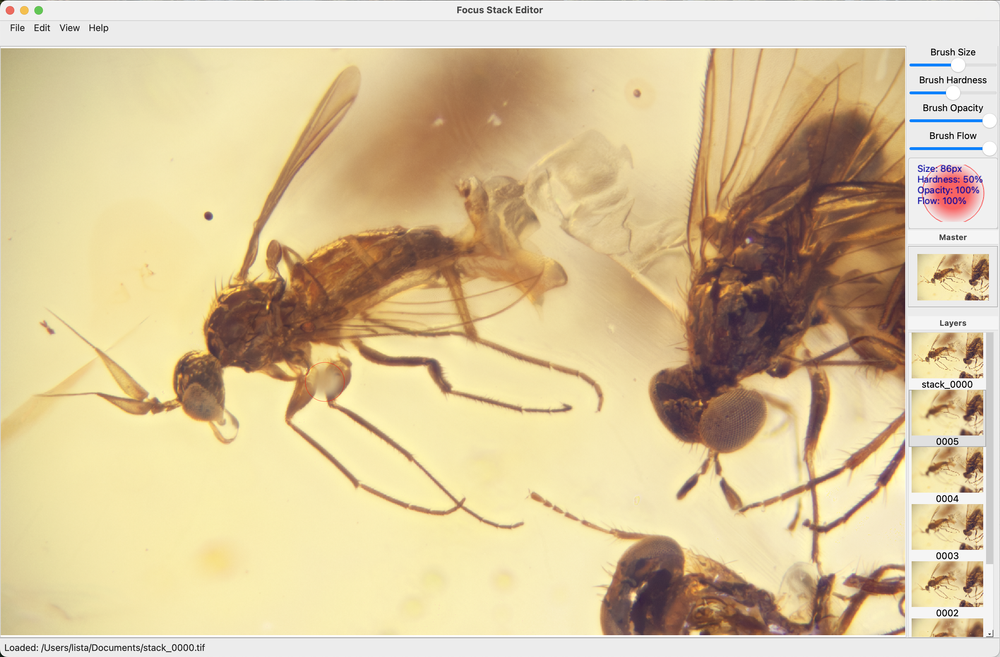

# Graphical User Interface

## Introduction
FocusStack processes focus-bracketed images in two phases:
* **Project**: Batch processing (alignment/balancing/stacking)
* **Retouch**: Layer-based refinement
> [!NOTE]
> Advanced processing details in [main documentation](main.md).

The batch processing supports image alignment, color and luminosity balance, vignetting removal,
noisy pixel masking.

## Starting

* The Python package can be installed from [PyPI](https://pypi.org/project/shinestacker/) using ```pip```:

```console
> pip install shinestacker
```
The release builds include the optional OpenCL implementation of SIFT for alignment (see [alignment](alignment.md)). To install it with the Python package, run:

```console
> pip install shinestacker[opencl]
```
Once installed, launch the GUI from the command line:

```console
> shinestacker
```

* The app can be downloaded from the [releases page](https://github.com/lucalista/shinestacker/releases):
   - Windows: as an installer or ```zip``` archive for local installation
   - macOS: as a ```dmg``` disk image; drag the app to the Applications folder
   - Linux: as a ```tar.gz``` archive

The GUI has two main working areas: 

* *Project* 
* *Retouch*

Switching from *Project* to *Retouch* can be done from the *ShineStacker* main menu.

## Project area

When the app starts, it prompts you to create a new project.



### Creating Projects
1. Select source folder (JPEG/TIFF 8/16-bit)
2. Configure job actions (auto-saved in project file)
3. Run processing:
   - Real-time logs & progress bar
   - Thumbnail previews for each stage

> **Try it yourself:** Use the [amber-flies sample images](https://github.com/lucalista/shinestacker/releases/latest/download/amber-flies.zip) as your source folder. The [video tutorial](https://www.youtube.com/watch?v=Ut5tJw63_HU) shows the GUI workflow.



> **Large Set Tip**: For 100+ images:
> - Split into 10-15 image "bunches" 
> - Set number of overlapping frame from consecutive bunches
> - Combine intermediate results later

The newly created project contains a single job with multiple actions.
By default, each action writes its output to a folder named after the action.
Some actions can be combined in order to produce a single intermediate output (alignment, balancing, etc.).

> **Pro Tip**: Duplicate jobs when processing similar image sets to save configuration time. You can run multiple jobs in sequence.

You can run a single job or all jobs in a project.



### Project Run Tabs

1. Job progress bar with CPU and RAM usage monitor
2. Real-time log viewer
3. Retouch button (enabled after processing)

When the job finishes, a *Retouch* button is enabled, which opens the output image into the retouch area.

## Retouch area



### Brush Properties
Adjust in the top toolbar:
- **Size**: Brush diameter (px)
- **Hardness**: Edge softness (0-100%)
- **Opacity**: Paint transparency
- **Flow**: Paint accumulation rate

> 💡 Pro Tip: Use low opacity/flow (20-40%) for subtle corrections

### Retouch Workflow

1. **Navigate**: 
   - Zoom/pan to defect area
   - Toggle between master/source (`X`)
2. **Correct defects/artifacts:**
   - Select source layer with clean area
   - Adjust brush properties (size/hardness/opacity)
   - Paint over defects
   - Use `Ctrl+Z` to undo strokes
3. **Verify**:
   - Toggle master view (`M`) to check results
   - Compare before/after with `L`/`M` toggle
4. **Filters**:
   - Improve the final image with sharpening, denoising, and color balancing
5. **Export**:
   - ✅ Final image: Single TIFF/JPEG 
   - 🗂️ Editable: Multilayer TIFF (large)

| Action              | Shortcut                  |
|---------------------|---------------------------|
| Zoom in/out         | `Ctrl` + `+`/`- or mouse wheel or pinch on touchpad |
| Reset view          | `Ctrl` + `0`              |
| Pan                 | `Space` + mouse drag or two fingers on touchpad   |
| Prev./next layer    | `Up`/`Down` arrows        |
| View master layer   | `M`                       |
| View source layer   | `L`                       |
| Toggle master ↔ layer | `T`                       |
| Temp. toggle master ↔ source | `X`                    |

See help menu for complete list of shortcuts.

**Export Formats**:
- Single TIFF: Final image (highest quality)
- Single JPEG: For web and quick preview (lower quality)
- Multilayer TIFF: Preserves all layers (large file)

**EXIF metadata**:
* EXIF data can be imported from source images and saved with the final file.


