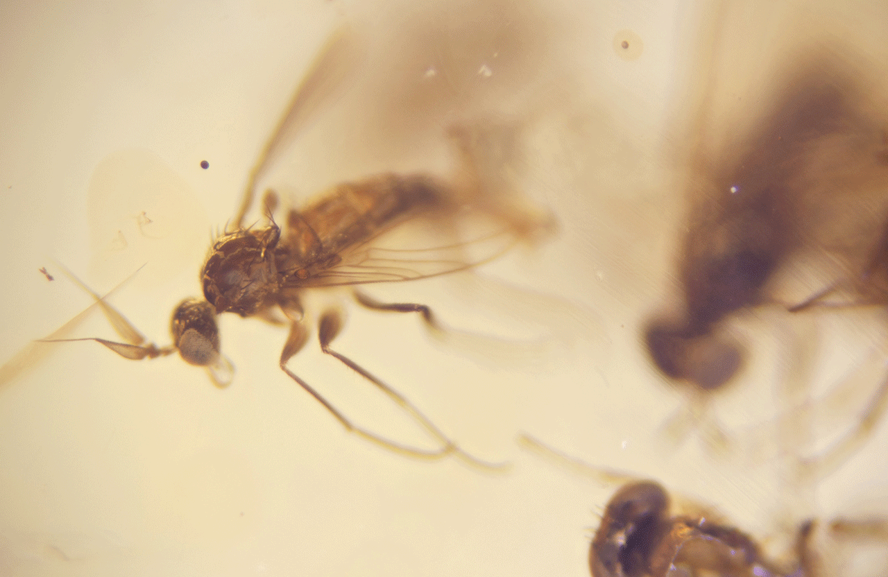
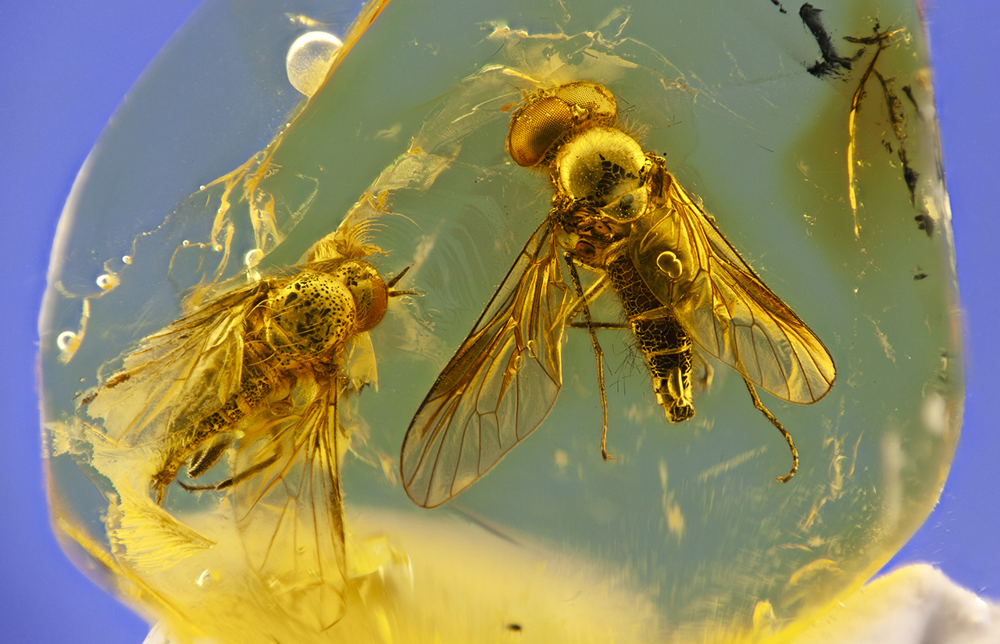

# Shine Stacker

## Focus Stacking Processing Framework and GUI

  

  

> **Focus stacking** for microscopy, macro photography, and computational imaging

## Key Features
- 📸 **Image Formats**: Supported input formats include JPEG, 8- and 16-bit TIFF and PNG, and most RAW formats. Output formats include JPEG and 8- and 16-bit TIFF and PNG. RGBA is supported for 16-bit TIFF and PNG.
- 🚀 **Batch Processing**: Align, balance, and stack hundreds of images
- 🧩 **Modular Architecture**: Mix-and-match processing modules
- 🖌️ **Retouch Editing**: Interactively retouch the stacked image using individual frames.
- 📊 **Jupyter Integration**: Image processing python notebooks


## Quick start
### Command Line Processing
```python
from shinestacker.algorithms import *

# Minimal workflow: Alignment → Stacking
job = StackJob("demo", "/path/to/images", input_path="src")
job.add_action(CombinedActions("align", [AlignFrames()]))
job.add_action(FocusStack("result", PyramidStack()))
job.run()
```

## Installation
Clone the package from GitHub:

```bash
git clone https://github.com/lucalista/shinestacker.git
cd shinestacker
pip install -e .
```

You can start shinestacker with the command:

```bash
shinestacker
```

On Linux and other systems that require an extra level of protection, you may need to use ```pip``` in a virtual environment:

```bash
git clone https://github.com/lucalista/shinestacker.git
cd shinestacker
python -m venv .venv
source .venv/bin/activate
pip install -e .
```

When using a virtual environment, you can start shinestacker with the commands:

```bash
cd shinestacker
source .venv/bin/activate
shinestacker
```

Note that, depending on your installation, you may need to use ```python3``` and ```pip3``` instead of
```python``` and ```pip```, respectively.


If you wish to use the faster implementation of the ```SIFT``` alignment method based on [```silx```](https://github.com/silx-kit/silx), you need to install the extra package ```shinestacker[opencl]```:

```bash
pip install shinestacker[opencl]
```

On some shells, such as ```zsh```, you need to quote the command so the square brackets are interpreted correctly: ```pip install "shinestacker[opencl]"```.

## GUI Workflow
Launch GUI

```bash
shinestacker
```

Follow [GUI guide](gui.md) for batch processing and retouching.


## Advanced Processing Pipeline

```python
from shinestacker import *

job = StackJob("job", "E:/focus_stacking/project_directory/", input_path="tiff_images")
job.add_action(CombinedActions("align", actions=[AlignFrames(), BalanceFrames()]))
job.add_action(FocusStackBunch("batches", PyramidStack(), frames=12, overlap=2))
job.add_action(FocusStack("stack", PyramidStack(), prefix='pyram_'))
job.add_action(FocusStack("stack", DepthMapStack(), prefix='dmap_'))
job.run()
```

## Workflow Options

| Method            | Best For         |
|-------------------|------------------|
| Python API        | batch processing | 
| GUI Interactive   | refinement       |
| Jupyter notebooks | prototyping      |

## Documentation Highlights
### Core Processing
- [Graphical User Interface](gui.md)
- [Image alignment](alignment.md)
- [Luminosity and color balancing](balancing.md)
- [Stacking algorithms](focus_stacking.md)
### Advanced Modules
- [Noisy pixel masking](noise.md)
- [Vignetting correction](vignetting.md)
- [Multilayer image](multilayer.md)

## Requirements

* Python: 3.12, 3.14
* RAM: 16GB+ recommended for >15 images at 20Mpx resolution

## Dependencies

### Core processing
```bash
pip install imagecodecs matplotlib numpy opencv-python pillow psdtags psutil rawpy scipy setuptools-scm tifffile tqdm
```
## GUI support
```bash
pip install argparse PySide6 jsonpickle webbrowser
```

## Jupyter support
```bash
pip install ipywidgets
```

## Known Issues

* EXIF data is not supported for 16-bit PNG or TIFF files.
* EXIF data from RAW images may be incomplete, depending on the camera manufacturer.
* Not all EXIF exposure data in TIFF files may display correctly in Adobe Photoshop. If needed, export as JPEG for full Photoshop EXIF compatibility. Shine Stacker can read a TIFF file, import EXIF data from a JPEG, and save the result as a JPEG with the imported EXIF data.
* Windows with ARM64 architecture is not supported in a straightforward way due to missing builds of some of the used libraries
* GUI tests are limited. Please report any bugs as [GitHub issues](https://github.com/lucalista/shinestacker/issues/).

