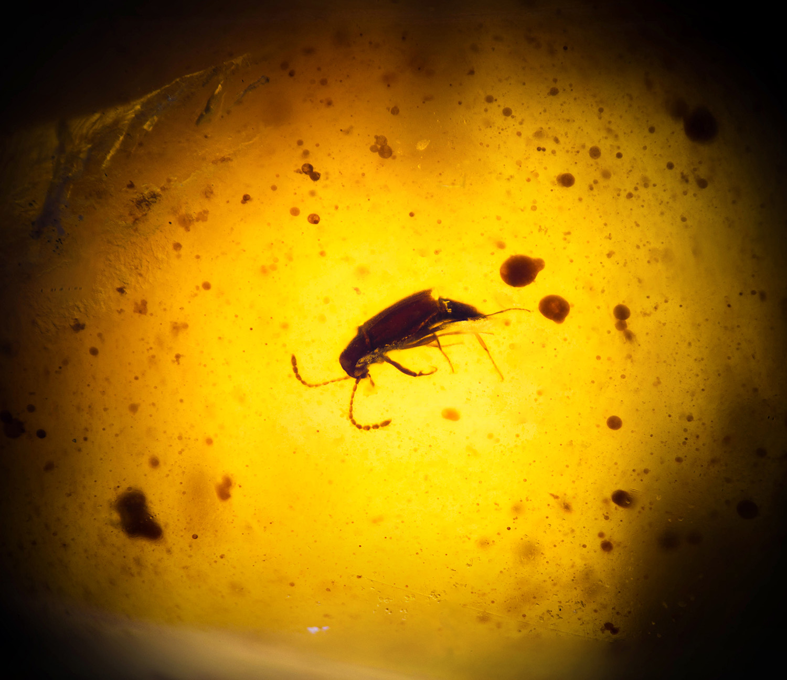

# Vignetting correction

```python
job.add_action(Actions("vignette", [Vignetting(*options)])
```

Applies a radial luminosity correction based on mean pixel luminosity to reduce vignetting at the image borders. The correction is determined by modeling mean luminosity as a function of the distance $r$ from the image center using the following asymmetric sigmoid model:

$\displaystyle i(r) = \frac{i_0}{1 + \exp(\exp(k(r - r_0)))}\,$

where the parameters $i_0$, $k$ and $r_0$ are estimated from the image luminosity data.
               
Arguments for the constructor of ```Vignetting``` are:
* ```name``` (optional, default: empty): only used in the GUI as identifier
* ```enabled``` (optional, default: ```True```): enable or disable the sub-action
* ```r_steps``` (optional, default: 100): number of radial steps used to calculate mean pixel luminosity.
* ```black_threshold``` (optional, default: 1): apply the correction only to pixels with luminosity above this threshold.
* ```max_correction``` (optional, default: 1): if less than one, the correction is rescaled so that it does not exceed this value.
* ```subsample``` (optional, default: 0=automatic): extracts the intensity histogram using every n-th pixel in each dimension to reduce processing time.
* ```plot_correction```  (optional, default: ```False```): if ```True```, plots the vignetting correction curve for each frame.
* ```plot_summary```  (optional, default: ```False```): if ```True```, plots a summary histogram of the vignetting correction levels.
* ```enabled``` (optional, default: ```True```): enables or disables this module.

## Extreme vignetting

⚠️ Vignetting can be very strong near the image edges in extreme macro photography with [reversed lenses](https://digital-photography-school.com/reverse-lens-macro-close-up-photography-lesson-3/). In the worst cases, the outer part of the image becomes almost or completely black. Vignetting correction cannot recover those very dark areas, but it can make the central part more uniform; the image will still need to be cropped.


